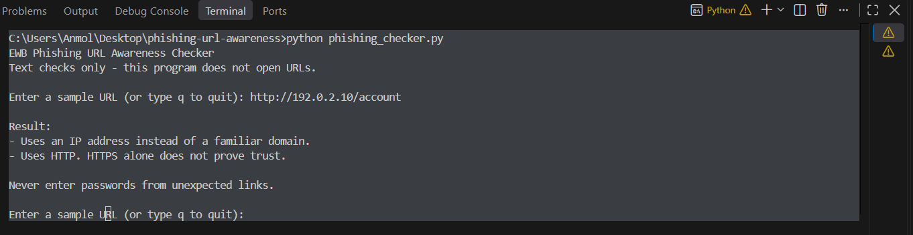
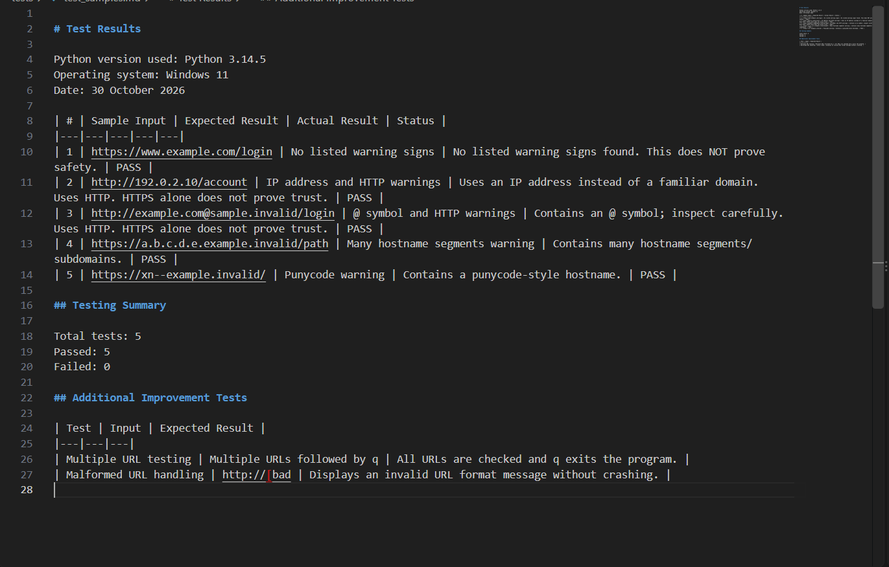

# EWB Phishing URL Awareness Checker

## Overview

Phishing is a cyberattack in which attackers use fake links or messages to trick people into sharing sensitive information.

This Python project checks URL text for six common warning signs and displays findings to help users become more aware of suspicious links.

## Features

- Detects the @ symbol in a URL.
- Identifies unusually long URLs (over 100 characters).
- Detects IP addresses used as hostnames.
- Identifies hostnames with five or more segments.
- Detects punycode markers (xn--).
- Identifies URLs using HTTP.
- Allows multiple URLs to be checked in one session.
- Handles malformed URL input.

## Requirements

- Python 3.10 or later.
- Visual Studio Code (recommended).
- No additional Python packages required.

## How to Run

1. Download or clone this repository.
2. Open the project folder in VS Code.
3. Open the terminal.
4. Run:

   python phishing_checker.py

5. Enter a sample URL.
6. Type q to quit.

## Example Output

EWB Phishing URL Awareness Checker

Text checks only - this program does not open URLs.

Result:
- Uses an IP address instead of a familiar domain.
- Uses HTTP. HTTPS alone does not prove trust.

## Testing

Five sample URLs were tested.

See tests/test_samples.md for the detailed testing report.

## Screenshots

### Program Output

### Test Results

## Improvements

1. Repeat-until-quit menu:
   Allows users to inspect multiple URLs without restarting the program.

2. Malformed URL handling:
   Handles incorrectly formatted URL input without crashing.

## Limitations

- This project only analyses URL text.
- It does not open or visit websites.
- It does not scan for malware.
- It does not use online reputation services.
- No warning signs found does NOT mean a URL is safe.
- The six checks are warning clues, not proof of malicious activity.

## Ethical Use

- Use sample URLs for testing.
- Do not collect passwords or credentials.
- Do not open suspicious links to test them.
- Do not scan websites without permission.
- Never claim that this tool definitively identifies safe or malicious websites.

## Author

Name: Ranveer Singh

Project: EWB Phishing URL Awareness Checker
